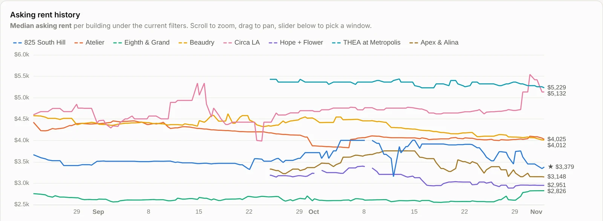
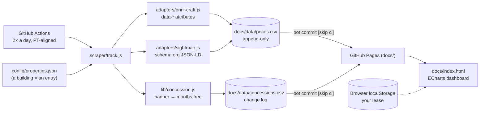

# DTLA Rent Tracker

**Renewal leverage, from public data.**

Asking-rent history for **825 South Hill** and seven downtown LA comps
(Atelier, Eighth & Grand, Beaudry, Circa LA, Hope + Flower, THEA at
Metropolis, Apex & Alina), scraped twice a day, so there is a price history
on the table at renewal time.

**Live dashboard:** https://ethanalong.github.io/dtla-rent-tracker/



<sub>Node · fetch + cheerio · GitHub Actions · GitHub Pages · ECharts · 中文 / English</sub>

---

## Problem

At renewal the landlord quotes one number and the tenant has nothing to
compare it with: leasing sites show today's asking rents only, they change
overnight, and advertised concessions ("up to 2 months free") make the
sticker price misleading.

## What it does

- Scrapes every available unit in eight buildings at 07:20 and 16:20 PT and
  appends one row per unit to `docs/data/prices.csv` (~355 units a scrape,
  41k+ rows since 2026-08-22).
- Logs each building's concession banner when its text changes, parses it
  into months free / scope / deadline, and can fold it into every chart as
  an effective rent (labelled an upper bound).
- Publishes a zoomable dashboard: trend per building, $/sqft, size-vs-rent
  scatter, scrape-to-scrape diff, unit table with days on market.
- Your own lease (unit, rent, end date) is entered in the browser and stays
  in `localStorage`; it is never committed, so the repo can stay public.

## Architecture



## Onboarding a new building

`node scraper/probe.js <url>` answers in one run whether a building can be
tracked and how: an Engrain SightMap id (config entry only, no code), an
Onni Craft site (config entry only), server-rendered prices (a small new
adapter), or JS / Cloudflare only (needs a browser; decide if it's worth it).
It also prints any concession banner with a CSS selector for the config.
The same probe runs in CI on every change to the scraper or the building
list, for when your own network can't reach the leasing sites.

## Design decisions and trade-offs

- **No browser.** Every source is server-rendered HTML or a JSON blob, so a
  whole run is plain `fetch()` + cheerio: seconds, not minutes, and no
  Chromium in CI.
- **Read attributes and JSON, never rendered text.** `data-rent-min` and
  JSON-LD survive a copy change; innerText doesn't.
- **A stale selector must not look like an ended offer.** A banner check
  returns `active`, `ended` or `check` (selector found nothing but the page
  still advertises free rent). `check` keeps the last known offer, prints a
  CI error and shows a red warning on the dashboard instead of logging a
  fake "offer ended".
- **Scrape everything, filter in the dashboard.** No bed / size filter in
  the scraper, so new questions don't need a re-scrape.
- **Data next to the page.** The CSVs live under `docs/`, so the dashboard
  reads them with a relative path: no raw.githubusercontent, no cache-bust.

## What the data is and isn't

Public **asking** rents, not signed-lease rents. Concession figures are the
banners' advertised **maxima**; read the building's own page before quoting
a number in a negotiation.

## Run it yourself

```bash
npm install
npm run track                    # one scrape of all eight buildings
DRY=1 node scraper/track.js atelier   # one building, print rows, write nothing
cd docs && python3 -m http.server 8731   # dashboard at http://127.0.0.1:8731
```

Autopilot: push to GitHub, then Settings → Pages → `main` / `/docs`. The
workflow in `.github/workflows/track.yml` scrapes and commits the CSV back.

## Next

- 12-month price for the home building: it lives in the application flow,
  which blocks a plain fetch, so it needs a browser session.
- More comps (candidates and why each is or isn't trackable are in `CLAUDE.md`).
- Retention pruning once the CSV passes a few MB.

Architecture notes, data caveats and the full add-a-building guide:
[`CLAUDE.md`](CLAUDE.md).
